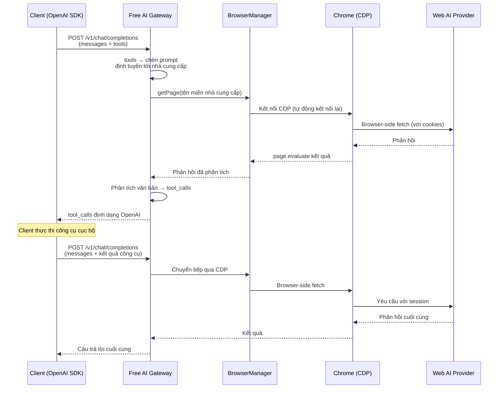

# Free AI Gateway

Sử dụng ChatGPT, Claude, Gemini, DeepSeek và 12 nhà cung cấp AI khác — **hoàn toàn miễn phí, không cần API key**. Chỉ cần đăng nhập qua trình duyệt.

Free AI Gateway là một máy chủ API tương thích OpenAI nhẹ, biến các phiên AI dựa trên web thành một endpoint chuẩn `/v1/chat/completions` với hỗ trợ **Tools / Function Calling** đầy đủ. Chỉ cần trỏ bất kỳ client SDK OpenAI nào về nó và nó hoạt động ngay.

## Tại sao chọn Free AI Gateway?

| Phương pháp truyền thống | Free AI Gateway         |
| ------------------------ | ----------------------- |
| Mua token API            | **Hoàn toàn miễn phí**  |
| Trả tiền theo yêu cầu    | Không giới hạn, không tính phí |
| Yêu cầu thẻ tín dụng     | Chỉ cần đăng nhập trình duyệt |
| API key có thể rò rỉ     | Credentials lưu trữ cục bộ |

## Bạn sẽ nhận được gì

- **Một endpoint, 13 nhà cung cấp** — Claude, ChatGPT, DeepSeek, Doubao, Gemini, GLM, GLM Intl, Grok, Kimi, Perplexity, Qwen, Qwen CN, Xiaomi MiMo
- **100% tương thích OpenAI** — `/v1/chat/completions`, `/v1/models`, streaming, tool_calls — không cần thay đổi phía client
- **Hỗ trợ Function Calling đầy đủ** — các công cụ được tiêm dưới dạng prompt, phản hồi được phân tích lại thành `tool_calls` chuẩn
- **Một file nhị phân, đầy đủ** — `playwright-core` được đóng gói; **chỉ có một phụ thuộc bên ngoài** là Chrome
- **Đa nền tảng** — macOS, Linux, Windows
- **Chế độ daemon** — `start` / `stop` / `restart` / `status` như một dịch vụ thực thụ

---

## Điều kiện tiên quyết

**Chrome (hoặc Chromium)** — Cài đặt từ [google.com/chrome](https://www.google.com/chrome/) hoặc trình quản lý gói của hệ điều hành. Giữ cập nhật phiên bản **ổn định mới nhất**. Cổng truy cập điều khiển trình duyệt của bạn qua CDP — **không nhịễn nhún trình duyệt**.

Đó là tất cả. `playwright-core` đã được đóng góp trong file nhị phân; không cần `playwright install`, không có phụ thuộc thời gian chạy nào thêm.

> **Phiên bản Chrome của tôi có cần "khớp" với phiên bản nào không?** — Không. Cổng truy cập kết nối tới WebSocket debug của Chrome; CDP duy trì tính tương thích xuyên các phiên bản Chrome gần đây.

---

## Cài đặt nhanh

### Bước 1 — Cài đặt

Chọn **một** phương pháp:

**Qua npm** (được khuyến nghị):

```bash
npm install -g free-ai-gateway
```

**File nhị phân đã dựng sẵn** — tải từ [GitHub Releases](https://github.com/dinhdev666/free-ai-gateway/releases):

```bash
tar xzf free-ai-gateway-<nền-tảng>.tar.gz
chmod +x free-ai-gateway
```

**Từ nguồn:**

```bash
git clone git@github.com:dinhdev666/free-ai-gateway.git && cd free-ai-gateway
pnpm install
pnpm build    # → ./free-ai-gateway
```

### Bước 2 — Ủy quyền các nhà cung cấp

Chạy trình thủ công ủy quyền. Chrome sẽ **khởi động tự động** nếu chưa chạy ở chế độ debug:

```bash
free-ai-gateway webauth
```

Chrome mở trang đăng nhập cho tất cả 13 nhà cung cấp. Đăng nhập vào những nhà cung cấp bạn muốn sử dụng, sau đó nhấn **Enter** trong terminal. Chọn các nhà cung cấp để ủy quyền — credentials được lưu vào `~/.free-ai-gateway/auth-profiles.json`.

> **DeepSeek:** giữ trang chat DeepSeek mở trong khi chạy `webauth` — trình thủ công sẽ thu thập bearer token từ phiên hoạt động.
>
> **Mẹp:** nếu terminal không trở lại sau khi ủy quyền, nhấn **Ctrl+C** — credentials đã được lưu.

### Bước 3 — Khởi động cổng truy cập

```bash
free-ai-gateway start      # daemon nền (log: ~/.free-ai-gateway/gateway.log)
free-ai-gateway serve      # nền trước (dùng cho gỡ lỗi)
```

Cổng truy cập lắng nghe trên `http://localhost:20123` theo mặc định. Chrome được kiểm tra (và tự động khởi động nếu cần) trước khi daemon khởi động.

### Bước 4 — Sử dụng

Chỉ cần trỏ **bất kỳ** client SDK OpenAI nào về cổng truy cập:

```python
from openai import OpenAI

client = OpenAI(
    base_url="http://localhost:20123/v1",
    api_key="bat-ky-chuoi-nao",          # hoặc FAG_API_KEY của bạn nếu đã cấu hình
)

# Trò chuyện đơn giản
response = client.chat.completions.create(
    model="claude-sonnet-4-20250514",
    messages=[{"role": "user", "content": "Xin chào!"}],
)
print(response.choices[0].message.content)
```

**Function Calling** hoạt động ngay:

```python
response = client.chat.completions.create(
    model="claude-sonnet-4-20250514",
    messages=[{"role": "user", "content": "Thời tiết ở Tokyo thế nào?"}],
    tools=[{
        "type": "function",
        "function": {
            "name": "get_weather",
            "description": "Lấy thời tiết hiện tại cho một thành phố",
            "parameters": {
                "type": "object",
                "properties": {"city": {"type": "string"}},
                "required": ["city"],
            },
        },
    }],
)
# response.choices[0].message.tool_calls → tool_calls chuẩn OpenAI
```

**cURL:**

```bash
# Danh sách mô hình khả dụng
curl http://localhost:20123/v1/models

# Tạo trò chuyện
curl http://localhost:20123/v1/chat/completions \
  -H "Content-Type: application/json" \
  -d '{"model":"claude-sonnet-4-20250514","messages":[{"role":"user","content":"Xin chào!"}]}'
```

> Nếu bạn đã cài đặt `FAG_API_KEY`, thêm `-H "Authorization: Bearer <your-key>"` vào mỗi yêu cầu (ngoại trừ `/health`).

---

## Các nhà cung cấp hỗ trợ

| Nhà cung cấp | Tiền tố model | Phương thức xác thực    | Client                    |
| ------------ | -------------- | ----------------------- | ------------------------- |
| Claude       | `claude-*`     | Session cookie          | CDP (browser fetch)       |
| ChatGPT      | `chatgpt-*`    | Access token + cookie   | CDP (browser fetch)       |
| DeepSeek     | `deepseek-*`   | Bearer token + cookie   | CDP (browser fetch + PoW) |
| Doubao       | `doubao-*`     | Session cookie          | CDP (browser fetch)       |
| Gemini       | `gemini-*`     | Google SID cookie       | CDP (browser fetch)       |
| GLM (智谱)   | `glm-*`        | Refresh token cookie    | CDP (browser fetch)       |
| GLM Intl     | `glm-intl-*`   | Session cookie          | CDP (browser fetch)       |
| Grok         | `grok-*`       | SSO cookie              | CDP (browser fetch)       |
| Kimi         | `kimi-*`       | Access token            | CDP (browser fetch)       |
| Perplexity   | `perplexity-*` | Next-auth cookie        | CDP (browser fetch)       |
| Qwen         | `qwen-*`       | Session cookie          | CDP (browser fetch)       |
| Qwen CN      | `qwen-cn-*`    | XSRF + cookie           | CDP (browser fetch)       |
| Xiaomi MiMo  | `xiaomimo-*`   | Bearer token            | CDP (browser fetch)       |

> Tất cả các nhà cung cấp chia sẻ một `BrowserManager` tập trung duy trì một kết nối CDP đến Chrome với tự động kết nối lại và giám sát sức khỏe.

---

## Tham chiếu CLI

```
free-ai-gateway [lệnh] [tùy chọn]

Lệnh:
  serve               Khởi động ở nền trước (mặc định)
  start               Khởi động ở nền sau (daemon)
  stop                Dừng daemon đang chạy
  restart             Khởi động lại daemon
  status              Hiển thị trạng thái đang chạy
  webauth             Uỷ quyền các nhà cung cấp AI web
  chrome [start|stop] Khởi động/dừng Chrome ở chế độ debug

Tùy chọn:
  --help, -h          Hiển thị trợ giúp này
  --version, -v       Hiển thị phiên bản
```

---

## Cấu hình

Hai cách để cấu hình cổng truy cập — chọn cách nào phù hợp:

```
Biến môi trường FAG_*      ← mức ưu tiên cao nhất
        ↓ rơi xuống nếu không được thiết lập
~/.free-ai-gateway/config.json
        ↓ rơi xuống nếu không được thiết lập
Giá trị mặc định tích hợp             ← mức ưu tiên thấp nhất
```

### Cách A — File cấu hình (được khuyến nghị)

Khi **khởi động lần đầu**, cổng truy cập tự động tạo `~/.free-ai-gateway/config.json` với tất cả giá trị mặc định:

```json
{
  "port": 20123,
  "apiKey": "",
  "cdpUrl": "http://127.0.0.1:9222",
  "requestTimeoutSec": 300
}
```

Chỉnh sửa các trường bạn muốn thay đổi và để lại các trường còn lại như bản gốc.

| Trường                | Mặc định            | Mô tả                                                       |
| --------------------- | ------------------- | ----------------------------------------------------------- |
| `port`                | `20123`             | Cổng lắng nghe máy chủ                                      |
| `apiKey`              | `""` (vô hiệu hóa)  | Bearer token xác thực client; để trống = không xác thực     |
| `cdpUrl`              | `http://127.0.0.1:9222` | Điểm cuối Chrome DevTools Protocol                          |
| `requestTimeoutSec`   | `300`               | Thời gian chờ cho mỗi yêu cầu (giây) tới `/v1/chat/completions` |

### Cách B — Biến môi trường

Tất cả biến đều dùng tiền tố `FAG_` để tránh xung đột với phần mềm khác.

| Biến                    | Mặc định            | Mô tả                                                       |
| ----------------------- | ------------------- | ----------------------------------------------------------- |
| `FAG_PORT`              | `20123`             | Cổng lắng nghe máy chủ                                      |
| `FAG_API_KEY`           | `""` (vô hiệu hóa)  | Bearer token xác thực client; để trống = không xác thực     |
| `FAG_CDP_URL`           | `http://127.0.0.1:9222` | Điểm cuối Chrome DevTools Protocol                          |
| `FAG_REQUEST_TIMEOUT_SEC`| `300`               | Thời gian chờ cho mỗi yêu cầu (giây) tới `/v1/chat/completions` |

Bạn cũng có thể đặt chúng trong file `.env` cùng thư mục với file nhị phân:

```bash
FAG_PORT=20123
FAG_API_KEY=my-secret-key
FAG_CDP_URL=http://127.0.0.1:9222
FAG_REQUEST_TIMEOUT_SEC=300
```

> **Lưu ý:** Biến môi trường luôn có mức ưu tiên cao hơn `config.json`, vì vậy bạn có thể dùng file cho giá trị mặc định và ghi đè từng giá trị riêng lẻ bằng biến môi trường.

---

## Endpoint API

| Phương thức | Đường dẫn            | Xác thực | Mô tả                                  |
| ------------ | -------------------- | -------- | -------------------------------------- |
| `POST`       | `/v1/chat/completions` | Bắt buộc | Tạo trò chuyện (streaming + không streaming) |
| `GET`        | `/v1/models`         | Bắt buộc | Liệt kê mô hình từ các nhà cung cấp đã ủy quyền |
| `GET`        | `/v1/models/:id`     | Bắt buộc | Lấy chi tiết mô hình                    |
| `GET`        | `/health`            | Công khai | Kiểm tra sức khỏe (CDP trình duyệt + trạng thái session) |

> "Bắt buộc" có nghĩa là header `Authorization: Bearer <FAG_API_KEY>` được kiểm tra **chỉ khi** `FAG_API_KEY` được cấu hình. Nếu chưa cài đặt, tất cả endpoint đều mở.

---

## Cách hoạt động



Tất cả yêu cầu API tới các nhà cung cấp AI web đều được thực thi **trong trình duyệt** thông qua Chrome DevTools Protocol (CDP), vượt qua Cloudflare và các hệ thống bảo vệ bot khác. Một `BrowserManager` singleton tập trung quản lý kết nối CDP chung với tự động kết nối lại, giám sát sức khỏe, và tự động khởi động Chrome.

---

## Tương thích nền tảng

| Tính năng                           | macOS | Linux | Windows                          |
| ----------------------------------- | ----- | ----- | -------------------------------- |
| Cổng truy cập (`serve`/`start`/`stop`) | ✅    | ✅    | ✅                              |
| Lệnh `chrome`                       | ✅    | ✅    | ✅                              |
| `start-chrome-debug.sh`             | ✅    | ✅    | ✅ (dùng `chrome start` thay thế) |
| Tất cả nhà cung cấp                 | ✅    | ✅    | ✅                              |

---

## Script phát triển

```bash
pnpm dev         # Máy chủ dev với hot reload
pnpm test        # Unit tests
pnpm check       # Kiểm tra lint + định dạng Biome
pnpm lint:fix    # Tự động sửa tất cả vấn đề
pnpm typecheck   # Kiểm tra kiểu TypeScript
pnpm build       # Biên dịch TypeScript → bundle esbuild
```

---

## Xử lý sự cố

| Vấn đề                          | Giải pháp                                                                     |
| ------------------------------- | ------------------------------------------------------------------------------ |
| `/v1/models` trả về rổng        | Chạy `free-ai-gateway webauth` để ủy quyền các nhà cung cấp                  |
| `/health` trả về `degraded`     | Chrome không thể truy cập — chạy `free-ai-gateway chrome start`             |
| webauth treo                     | Nhấn **Ctrl+C** — credentials đã được lưu                                     |
| Tự động khởi động Chrome thất bại | Chạy `free-ai-gateway chrome start` thủ công, sau đó chạy lại `webauth`      |
| Cổng Chrome 9222 đã được sử dụng  | Dừng quá trình xung đột: `lsof -i:9222` / `netstat -ano \| findstr 9222`   |
| Xác thực DeepSeek thất bại        | Giữ trang chat DeepSeek mở trong khi chạy `webauth`                           |
| Daemon không khởi động          | Kiểm tra log: `~/.free-ai-gateway/gateway.log`                              |
| Yêu cầu treo / timeout 504       | Tăng `requestTimeoutSec` hoặc kiểm tra sức khỏe session upstream             |
| `/health` trả về `session_expired` | Session nhà cung cấp đã hết hạn — chạy `free-ai-gateway webauth` để ủy quyền lại |

---

## Lời cảm ơn

Dự án này được tái thiết kế và tinh lọc từ [openclaw-zero-token](https://github.com/linuxhsj/openclaw-zero-token), trích xuất lớp nhà cung cấp AI web và mô-đun tương thích OpenAI thành một cổng truy cập độc lập, nhẹ, tập trung hoàn toàn vào việc chuyển đổi giao thức.

## Giấy phép

MIT. © 2025 Phạm Văn Đinh.
